<div align="center">

<a href="https://geonyworks.com"></a>

<a href="https://geonyworks.com"></a>

[](https://geonyworks.com)
[](https://play.google.com/store/apps/details?id=com.geonyworks.mallangadventure)
[](mailto:tjsrjs21@gmail.com)

</div>

<br />

## ⚡ About

> **만들고 끝이 아니라, 실제 사용자가 쓰고 결제가 일어나는 제품까지.**

거니웍스(GEONY WORKS) 대표 **유선건**입니다.  
아이디어 한 줄을 **기획 → 디자인 → 개발 → 배포 → 실사용자 운영 → 수익화**까지 끝까지 끌고 갑니다.  
그 전 과정을 **AI 에이전트 하네스** — 서브에이전트 · 스킬 · MCP · 워크플로 — 위에서 돌립니다. 사람은 한 명, 팀은 하네스로.

- 🏢 **GEONY WORKS** — 웹 · 앱 · 게임 개발 스튜디오. 기획 · 브랜딩 · UI/UX부터 로그인 · 결제 연동, 서버 · 배포, SEO까지 한 번에.
- 💰 **실사용자 · 수익화** — Google Play에 출시해 인앱 결제를 붙인 RPG, 실제 고객 결제가 들어오는 청첩장 서비스. 출시 뒤 공지 · 이벤트 · 밸런스 · 고객 응대까지 직접 운영합니다.
- 🎬 **영상 현지화 스튜디오** — 한국어 영상 하나를 나라별 자막 · 게시 글 · 연출 자막으로. 마케팅 회사용으로 직접 만들어 2026년 12월에 엽니다.
- 🧠 **Harness Engineering** — 저장소마다 규칙(`CLAUDE.md` · `AGENTS.md`)과 인계 문서(`HANDOFF.md`), 검증 게이트(`npm run verify`)를 깔고 일을 맡깁니다. "다 했어요"가 아니라 검증이 통과해야 끝.
- 🌏 **한국어 · Tiếng Việt** — 제품 대부분을 두 언어로 설계합니다. 베트남어가 한국어보다 평균 2.9배 길다는 것까지 레이아웃 규칙에 넣어 둡니다.

<br />

## 🧠 How I Build — Harness Engineering

```ts
// 거니웍스 = 사람 1 + 하네스
const geonyworks = {
  plan:    "idea → spec → tasks",
  build:   "AI agents × isolated git worktrees",
  rules:   ["CLAUDE.md", "AGENTS.md", "HANDOFF.md"],
  skills:  ["superpowers", "higgsfield", "typecast"],
  mcp:     ["supabase", "vercel", "playwright", "chrome", "fal"],
  verify:  "npm run verify", // tsc · lint · vitest · playwright
  media:   ["ffmpeg", "libass", "vercel-sandbox"],
  ship:    ["vercel", "google-play", "github-actions"],
  operate: ["notices", "events", "balance", "support"],
  revenue: ["google-play-billing", "toss-payments"],
};
```

- 📜 **규칙은 사고에서 나온다** — 버그 하나가 규칙 한 줄이 됩니다. Doii · 말랑 모험 저장소의 `AGENTS.md`는 *어떤 버그에서 어떤 규칙이 나왔는지* 적어 둔 설계 사례집.
- 🌙 **자리를 비운 밤에도** — Workflow가 Build → Review(3관점) → Fix → 공지 · 인계까지 한 라운드를 끝까지 돌립니다.
- 🧪 **끝은 검증이 정한다** — typecheck · lint · Vitest · Playwright e2e. DB는 PGlite로 마이그레이션과 RLS까지 로컬에서 검증.
- 🔐 **경계는 서버에** — RLS로 막고, 결제 확정 · 보상 정산은 서버 RPC로만. 비밀값은 커밋 · 로그 · 대화에 남기지 않습니다.

<sub>📈 Doii · 말랑 모험 저장소 하나에만 커밋 1,800+ · Supabase 마이그레이션 2,100+ (2026-10 기준) · 거니웍스 저장소 테스트 1,800+ (2026-11 기준)</sub>

<br />

## 🚀 Products — 기획부터 수익화까지, 직접 운영 중

<p align="center">
  <a href="https://capdoii.com/play"></a>
  <a href="https://dearmio.com"></a>
  <a href="https://brickgo.kr">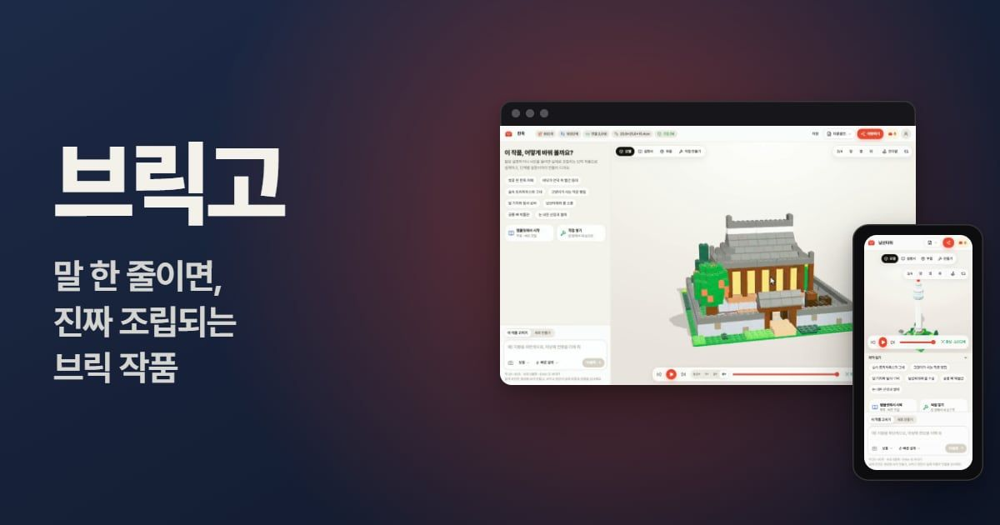</a>
  <a href="https://capdoii.com">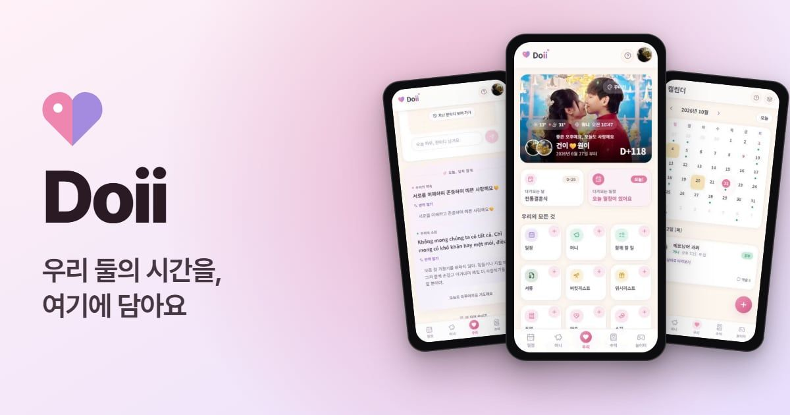</a>
  <a href="https://geonyworks.com/studio">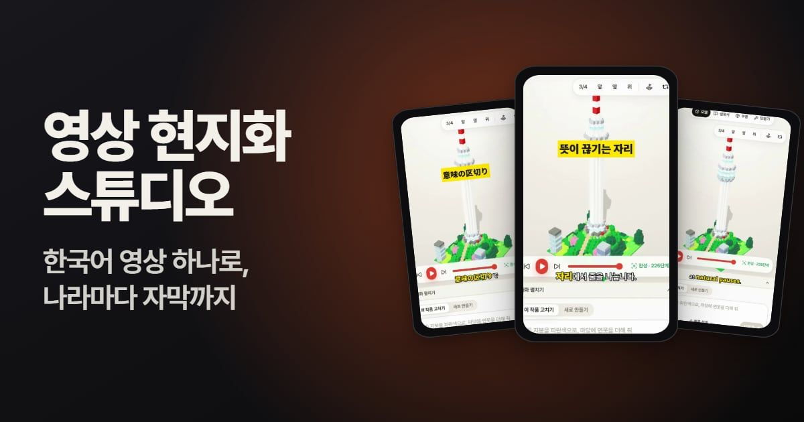</a>
  <a href="https://geonyworks.com">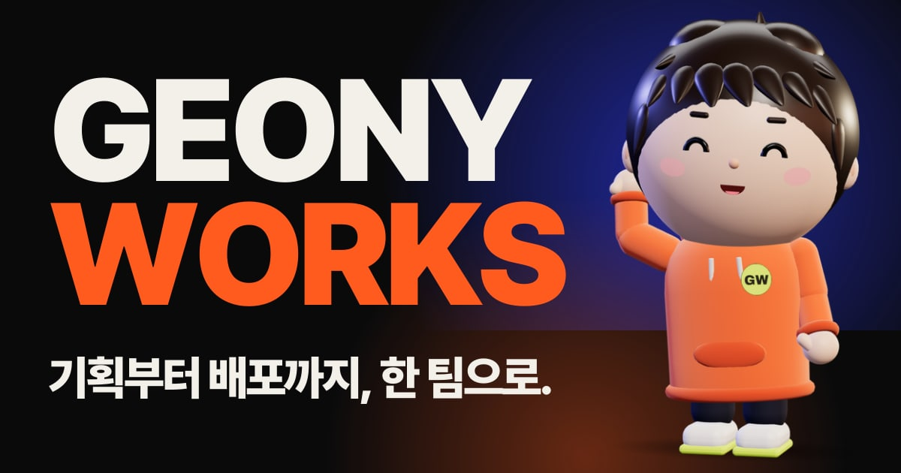</a>
  <a href="https://geonywony.com"></a>
  <a href="https://ailter.ai">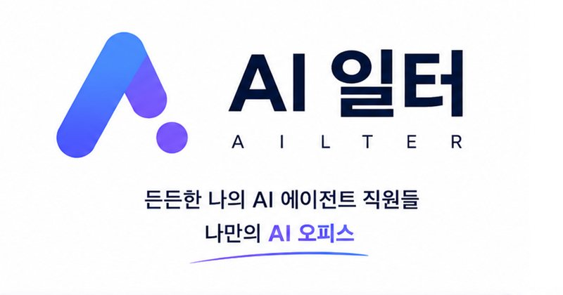</a>
</p>

### 🎮 [말랑 모험 · Malang Adventure](https://capdoii.com/play)

[](https://play.google.com/store/apps/details?id=com.geonyworks.mallangadventure)
[](https://capdoii.com/play)

두 영웅과 펫을 키우고, 강화 · 재련으로 장비를 다듬으며 층층이 보스를 넘는 귀여운 턴제 RPG. 웹과 Android 앱이 한 계정으로 이어지고 한국어 · 베트남어를 지원합니다.  
세계관 · 전투 연출 · 경제 밸런스 · 사운드부터 **Google Play 출시 · 인앱 결제(서버 검증)** 까지 직접 하고, 출시 뒤에도 이벤트 · 공지 · 밸런스를 계속 운영합니다. 콘텐츠는 전부 DB 표라 월드가 늘어도 코드에 분기가 없습니다.  
`Next.js` `Supabase (RLS · RPC · Realtime · pg_cron)` `Capacitor Android` `Google Play Billing` `Toss Payments` `Web Push` `Kakao` `fal.ai` `Higgsfield` `ElevenLabs` `Typecast`

### 💌 [Dearmio · 디어미오](https://dearmio.com)

감성 모바일 청첩장부터 돌잔치 · 생일 · 환갑 · 집들이 초대장까지 — 먼저 만들어 보고, 마음에 들면 결제하는 **유료 서비스**. 실제 고객 결제(토스페이먼츠)로 운영 중입니다.  
한 커플의 청첩장에서 시작해, 고객이 늘어도 코드를 고치지 않는 **한 저장소 · 한 배포** 서비스로 키웠습니다. 주문 · 결제 · 알림톡 · 식전영상 · 관리자 분석(유입 · 전환)까지.  
`Next.js` `Supabase` `Toss Payments` `Remotion` `Claude API` `Solapi` `Resend`

### 🧱 [브릭고 · BRICKGO](https://brickgo.kr) <sub>대표 개인 프로젝트 · 개발중</sub>

말 한 줄이나 사진 한 장으로 실제로 조립 가능한 브릭 작품을 설계하고, 조립 설명서 · 부품표까지 받아 가는 서비스.
AI가 실제 부품으로 설계한 뒤 모든 연결을 코드가 검사하고, 3D로 조립 순서대로 쌓아 보여 줍니다. 3D 스튜디오에서 직접 고치고, 설명서는 PDF로 받습니다.
`Next.js` `Claude API` `three.js` `Postgres` `Toss Payments` `jsPDF` `Zustand`

### 🎬 [영상 현지화 스튜디오](https://geonyworks.com/studio) <sub>2026-12 고객 오픈</sub>

마케팅 회사를 위한 작업 공간. 한국어 영상을 올리면 **받아쓰기 → 언어마다 번역 · 검수 → 나라별 게시 글 → 휴대폰 승인 → 자막 입히기 → 유튜브 · 인스타그램 · 페이스북 · 틱톡 발행**까지 한 화면에서.
연출 자막은 AI가 언어마다 핵심 낱말을 고르고(과장 표현은 고르지 않게) 말에 맞춰 튀어 오르게 하고, 화면 확대 · 키워드 카드 · 이름표까지 입힙니다. 긴 영상에서 숏츠 구간을 골라 세로로 자르는 것도 같이.
`Next.js` `Supabase (RLS · Storage)` `Claude API` `ElevenLabs Scribe` `Vercel Sandbox` `FFmpeg · libass` `YouTube Data API` `Instagram · Facebook Graph API` `TikTok API`

### 💞 [Doii · 도이](https://capdoii.com)

한국 · 베트남 커플을 위한 모바일 웹앱(PWA). 일정 · 두 통화 생활비 · 추억 · 예약 편지 · 놀이터를 두 사람이 각자의 언어와 시간대로 같이 씁니다. 다른 언어로 쓴 글에는 번역 버튼(Gemini).  
숨겨야 하는 값은 화면이 가리는 게 아니라 **RLS가 SELECT를 막습니다** — 보안 경계는 전부 서버.  
`Next.js` `Supabase Realtime` `RLS · SECURITY DEFINER RPC` `Gemini` `Web Push` `PWA`

### 🤖 [AI 일터 · AILTER](https://ailter.ai)

나만의 AI 직원들과 회의하고, 일을 맡기고, 모든 기록을 남기는 AI 오피스.  
대표(CEO) 에이전트가 일을 DAG로 쪼개 리서처 · 작가 · 디자이너 · 개발자 · 비서에게 넘기고, 직원은 도구를 직접 써서 결과를 확인한 뒤 답합니다. 원격 MCP 연결 · Obsidian 보관소 · 지식 그래프.  
`React` `Express` `Claude API (tool use)` `OpenAI` `Gemini` `Supabase pgvector` `MCP`

### 🏢 [GEONY WORKS · 거니웍스](https://geonyworks.com)

회사 공식 사이트. 15초 쇼릴 인트로, 외부 모델 없이 three.js 도형으로만 만든 3D 캐릭터 「거니」, 스크롤 스토리. 제안서 · 인보이스 · 고객 화면 · 관리자에 영상 스튜디오까지, 수주부터 청구까지 한 저장소에서.  
`Next.js 16` `React Three Fiber` `GSAP` `Lenis` `Supabase` `Typecast` `ElevenLabs Music`

### 🌏 [거니워니 · GeonyWony](https://geonywony.com)

한국 거니와 베트남 워니, 한베커플 이야기를 담은 공식 홈페이지. 카카오 · Google · Facebook 소셜 로그인, 유튜브 영상 · Shorts 허브, 앨범 플레이어, 따라오는 3D 무대와 AR 「내 방에 놓기」.  
`Next.js` `Supabase Auth` `three.js` `PostHog` `Playwright`

### 🎨 More Work

<p align="center">
  <a href="https://todays-meal-five.vercel.app">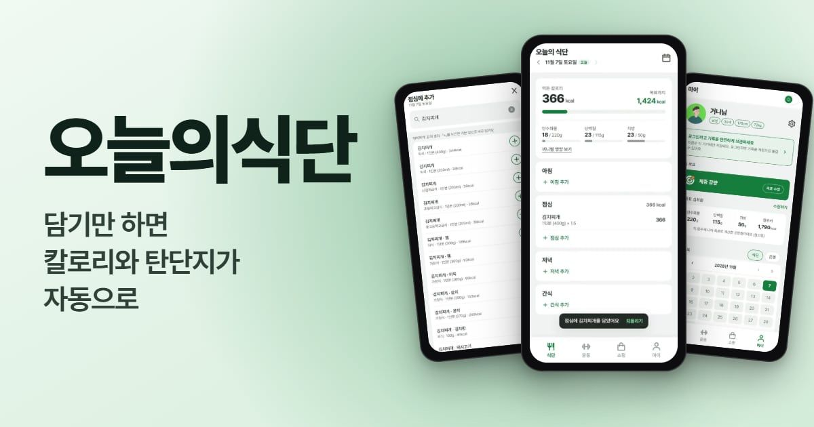</a>
  <a href="https://knives-out.vercel.app">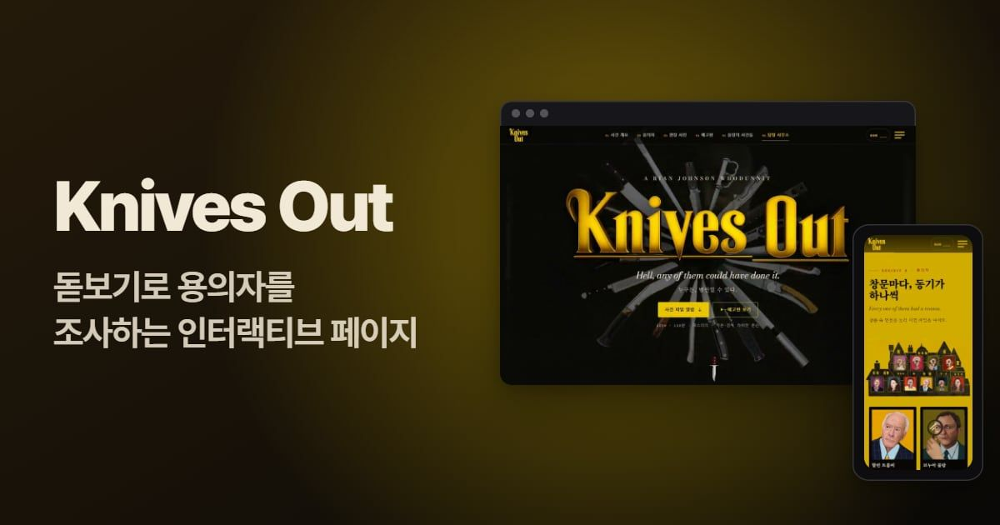</a>
  <a href="https://hollowknight-ashy.vercel.app">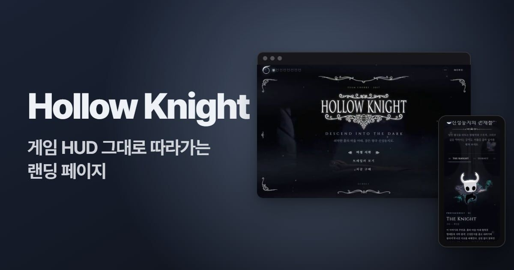</a>
  <a href="https://tjsrjs8282.github.io/hankuk/index.html"></a>
  <a href="https://tjsrjs8282.github.io/oculus/index.html">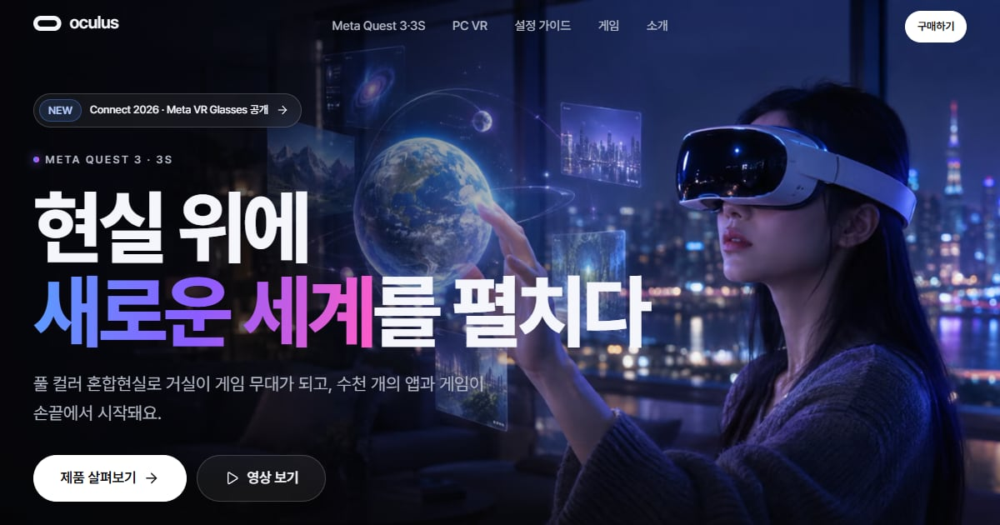</a>
  <a href="https://sungsimdang.co.kr">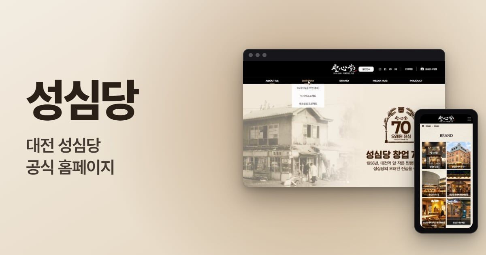</a>
</p>

- **[오늘의식단](https://todays-meal-five.vercel.app)** — 먹은 음식을 검색해 담기만 하면 칼로리와 탄단지가 자동으로 쌓이는 식단 · 운동 기록 앱(PWA).
- **[Knives Out](https://knives-out.vercel.app)** <sub>대표 개인 작업</sub> — 돋보기로 용의자 열 명을 조사하고 AI 블랑에게 일상의 미스터리를 의뢰하는 인터랙티브 페이지. <sub>영화 이미지 · 예고편 저작권 © Lionsgate · MRC · T-Street</sub>
- **[Hollow Knight](https://hollowknight-ashy.vercel.app)** <sub>대표 개인 작업</sub> — 게임 HUD 그대로 내려가는 랜딩 페이지, Web Audio 사운드트랙과 AI 예언자. <sub>게임 · 그림 저작권 © Team Cherry</sub>
- **[한국대학교](https://tjsrjs8282.github.io/hankuk/index.html)** · **[Oculus](https://tjsrjs8282.github.io/oculus/index.html)** <sub>대표 개인 작업</sub> — 2020년에 만든 사이트를 Astro로 다시 지었습니다. <sub>Oculus · Meta Quest 상표 © Meta</sub>
- **[성심당](https://sungsimdang.co.kr)** <sub>대표가 소속 회사에서 참여</sub> — 대전 성심당 공식 홈페이지.

<details>
<summary><b>더 보기 — KOVI · VIKO, Stock Scanner</b></summary>
<br />

**📚 KOVI · VIKO** <sub>출시 준비 중</sub>  
한국인을 위한 베트남어(KOVI)와 베트남인을 위한 한국어(VIKO) — 한 플랫폼, 두 앱. 발음 점수 · SRS 복습 · AI 상황회화 · 관리자 CMS를 같이 씁니다.  
`Expo` `React Native` `npm workspaces` `Supabase` `Vitest` `PGlite`

**📈 [Stock Scanner · 주식스캐너](https://www.stockscanner.co.kr)**  
미국 주식을 주봉 RSI로 스캔하고, 폴더별 워치리스트를 실시간 시세 카드로 봅니다.  
`Vite` `React` `Supabase` `Finnhub` `Vercel Functions` `PWA`

</details>

<br />

## 🧰 Stack & Toolbox

<p align="center">
  <picture>
    <source media="(prefers-color-scheme: dark)" srcset="https://skillicons.dev/icons?i=nextjs%2Creact%2Cts%2Cjs%2Chtml%2Ccss%2Ctailwind%2Castro%2Cvite%2Cthreejs%2Credux%2Cnodejs%2Cexpress%2Csupabase%2Cpostgres%2Cvercel%2Cgithubactions%2Cpython%2Cgit%2Cfigma%2Cps%2Cai%2Candroidstudio%2Cmd&perline=8&theme=dark">
    <source media="(prefers-color-scheme: light)" srcset="https://skillicons.dev/icons?i=nextjs%2Creact%2Cts%2Cjs%2Chtml%2Ccss%2Ctailwind%2Castro%2Cvite%2Cthreejs%2Credux%2Cnodejs%2Cexpress%2Csupabase%2Cpostgres%2Cvercel%2Cgithubactions%2Cpython%2Cgit%2Cfigma%2Cps%2Cai%2Candroidstudio%2Cmd&perline=8&theme=light">
    
  </picture>
</p>

| 영역 | 도구 |
| :-- | :-- |
| **Harness** |         |
| **MCP** |              |
| **Frontend** |                |
| **Motion&nbsp;·&nbsp;3D** |         |
| **Backend&nbsp;·&nbsp;Data** |             |
| **App&nbsp;·&nbsp;Game** |        |
| **AI&nbsp;API** |            |
| **Video&nbsp;·&nbsp;Audio** |            |
| **Design** |      |
| **Pay&nbsp;·&nbsp;Login** |        |
| **SNS&nbsp;·&nbsp;Data&nbsp;API** |         |
| **Message** |     |
| **SEO&nbsp;·&nbsp;Growth** |         |
| **Test&nbsp;·&nbsp;CI** |      |
| **Infra&nbsp;·&nbsp;Domain** |       |
| **Workbench** |         |

<br />

<div align="center">

<sub>기획 → 배포 → 실사용자 → 수익화 · GEONY WORKS</sub>


</div>
